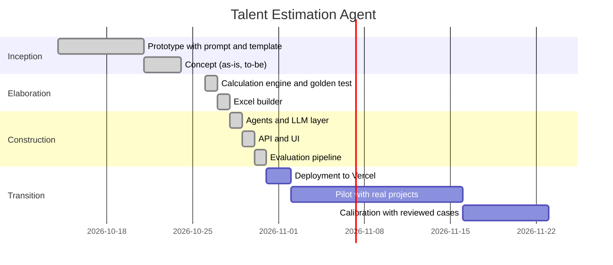

# Workplan

The project follows short iterations. Each iteration ends with something that
runs and can be shown.

## Work breakdown structure

| ID | Task | Deliverable |
|---|---|---|
| 1 | Planning | System request, feasibility, estimate |
| 2 | Analysis | Requirements, use cases, structural and behavioral models |
| 3 | Design | Architecture, agent contracts, UI design |
| 4.1 | Engine | `calc` package with golden test |
| 4.2 | Excel | `excel` package with LibreOffice recalculation test |
| 4.3 | Agents | `agents`, `skills`, `llm` packages |
| 4.4 | API | `api/index.py` |
| 4.5 | UI | Next.js application |
| 4.6 | Evaluation | Kedro project |
| 5 | Transition | Deployment, pilot, calibration |

## Risks

| Risk | Likelihood | Impact | Response |
|---|---|---|---|
| Model output varies between providers | High | Medium | Schema validation, retries, evaluation per provider |
| PHM calibrated on too few projects | High | High | Kedro calibration as soon as reviewed cases exist |
| WBS formats not recognised | Medium | Medium | Clear error message listing the expected columns; column inference planned |
| Results read as a headcount cut | Medium | High | Separate AI scenario; mandatory human review |
