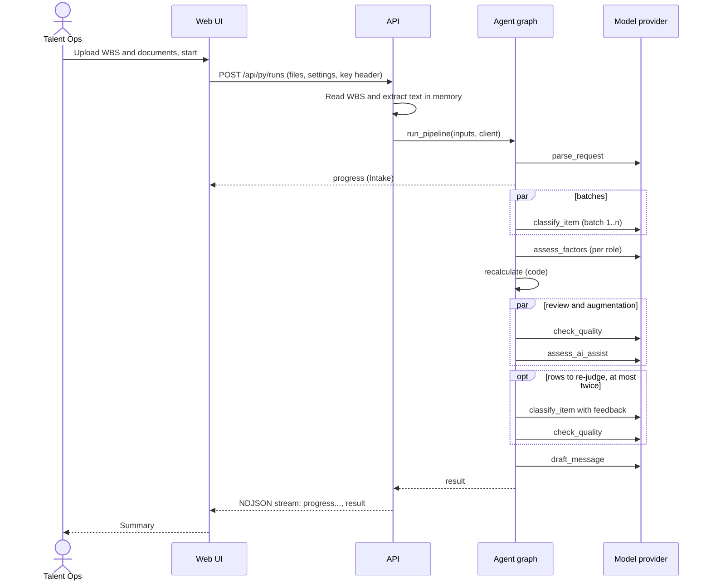
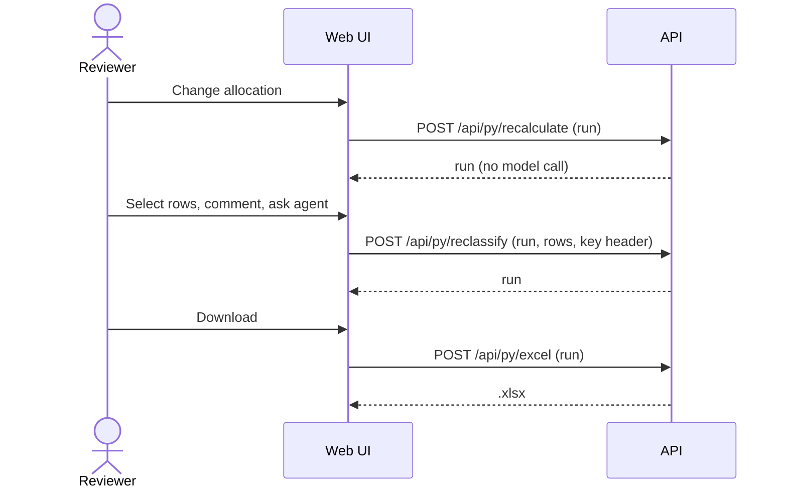
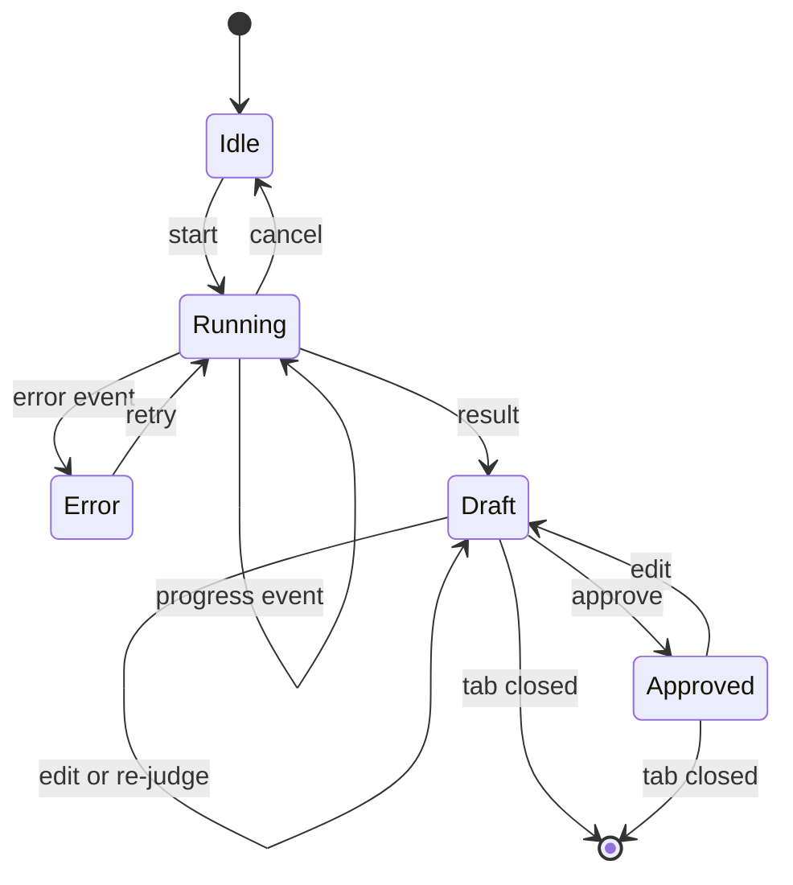

# Behavioral model

## Sequence: a run

## Sequence: review and export

## State machine of a run (in the browser)

## CRUDE matrix

C = create, R = read, U = update, D = delete, E = execute.

| Actor or component | WbsItem | BreakdownRow | RoleFactors | RoleEstimate | Finding | AiTask | Workbook |
|---|---|---|---|---|---|---|---|
| Intake Agent | C | | | | | | |
| Estimator Agent | R | CU | C | | | | |
| Engine | | R | R | CU | | R | |
| Reviewer Agent | R | RU | | R | C | | |
| Augmentation Agent | | R | | | | C | |
| Report | | R | R | R | R | R | |
| ExcelBuilder | R | R | R | R | R | R | C |
| Reviewer (human) | R | RU | R | R | R | RU | E |
