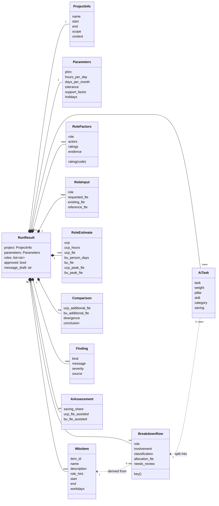
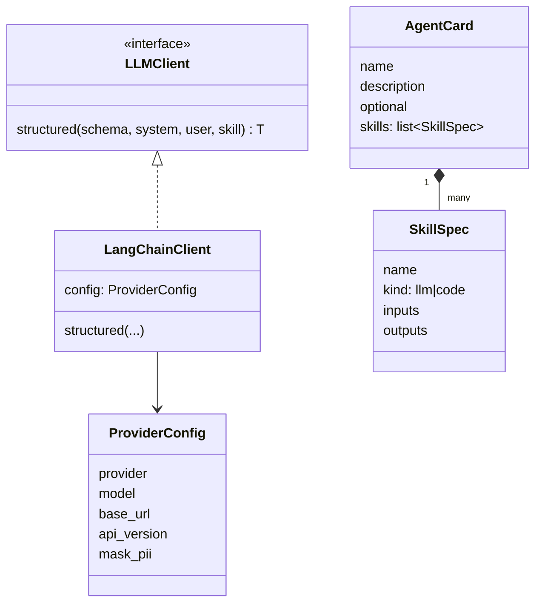

# Structural model

## CRC cards

| Class | Responsibilities | Collaborators |
|---|---|---|
| WbsItem | Hold one leaf work package: ID, name, description, role hint, dates, working days, group | WbsReader |
| BreakdownRow | Hold one item for one role with involvement, class, allocation, reasons, review flag | WbsItem, Estimator, Engine |
| RoleFactors | Hold UCP actors and factor ratings with evidence for one role | Estimator, Engine |
| Parameters | Hold PHM, hours per day, days per month, tolerance, support factor, holidays, weights | Engine, ExcelBuilder |
| RoleEstimate | Hold UCP and bottom-up effort and FTE for one role | Engine |
| Comparison | Compare calculated need with request, existing talent, and reference | Engine |
| Finding | Describe a gap, overlap, divergence, data issue, or assumption | Reviewer, Engine |
| AiTask | Describe one task, its capability, AI category, weight, and saving | Augmentation, Engine |
| RunResult | Aggregate everything produced by one run; travel between browser and server | All |
| Catalog | Describe roles, rules, rubrics, and AI categories | Agents, ExcelBuilder |
| Engine | Recalculate every derived number from inputs | RunResult, Parameters |
| LLMClient | Return a validated object for a prompt from any provider | Skills |
| ExcelBuilder | Produce the workbook with formulas | RunResult, Catalog |

## Class diagram

## Agent and skill classes

