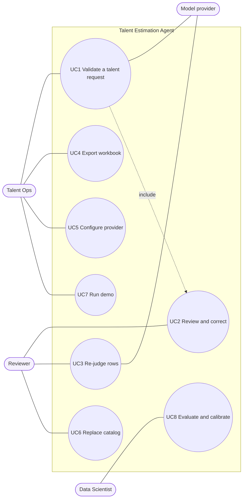

# Use cases

Mermaid has no native use-case diagram, so the diagram below uses a flowchart
with actors on the sides and use cases in the system boundary.

## UC1 Validate a talent request

| Field | Content |
|---|---|
| Primary actor | Talent Ops |
| Importance | High |
| Stakeholders | Talent Ops wants a fast answer; the reviewer wants traceable numbers; the requesting team wants a fair assessment. |
| Trigger | A talent request with a WBS arrives. |
| Preconditions | A model provider and key are configured, or the demo mode is used. |
| Normal flow | 1. The user uploads the WBS. 2. The system shows the number of leaf items and the period. 3. The user uploads the request and supporting documents (optional). 4. The user chooses the scope and, if needed, adjusts settings. 5. The user starts the run. 6. The Intake Agent reads the documents. 7. The Estimator Agent judges every item and calculates. 8. The Reviewer Agent checks the result and sends doubtful rows back (at most twice). 9. The Augmentation Agent maps AI assistance (if enabled). 10. The Report step drafts the message. 11. The system shows the summary. |
| Alternate flows | 2a. The WBS table is not recognised: the system explains which columns are expected. 6a. The request has no numbers: the comparison stays empty until the user enters them. 8a. The model returns invalid output twice: the run stops with a clear message. |
| Postconditions | The run is held in the browser tab. Nothing is stored on the server. |

## UC2 Review and correct

| Field | Content |
|---|---|
| Primary actor | Reviewer |
| Normal flow | 1. The reviewer opens the breakdown filtered to rows that need review. 2. The reviewer reads the reasons. 3. The reviewer changes involvement, class, or allocation. 4. The system recalculates every number without a model call. 5. The reviewer marks the result as approved. |

## UC3 Re-judge rows

| Field | Content |
|---|---|
| Primary actor | Reviewer |
| Normal flow | 1. The reviewer selects rows and writes a comment. 2. The Estimator Agent judges the rows again with the comment as feedback. 3. The system replaces the rows and recalculates. |

## UC4 Export workbook

The user downloads a workbook built from the current run, including edits. The
workbook stores formulas, so totals update when a reviewer edits an input in
Excel.

## UC5 Configure provider

The user chooses a provider, model, endpoint (for Azure and custom endpoints),
and key, and tests the connection. The key stays in the tab.

## UC6 Replace catalog

The reviewer uploads a capability catalog. It applies to the session only.

## UC7 Run demo

The user runs the full flow on a fictional project with the rule-based judge.

## UC8 Evaluate and calibrate

The data scientist runs the Kedro pipeline on reviewed cases to compare
providers and to calibrate PHM. See [evaluation](../04-implementation/evaluation.md).
