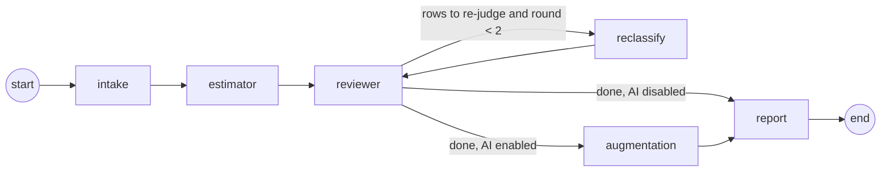

# Agents and skills

## Graph

The agents run in sequence. Augmentation runs after the review loop so that
the AI tasks are mapped to the final, reviewed breakdown rather than to rows
the reviewer may still change. The graph is compiled per request without a
checkpointer.

Runs with a model have a time budget of 270 seconds, because Vercel stops the
function at 300. With less than 60 seconds left the reviewer uses rules, with
less than 50 seconds augmentation is skipped, and the message draft falls back
to a template. Skipped steps are recorded as findings, and the FTE numbers are
always returned. A failed augmentation call is handled the same way. While a
model call is pending, the stream sends a heartbeat line every 10 seconds so
the connection never looks idle.

## Where agents decide

| Agent | Decision | Bounded by |
|---|---|---|
| Orchestrator | Roles in scope, whether augmentation runs, when to stop the loop | Scope setting, `MAX_REVIEW_ROUNDS = 2`, recursion limit |
| Intake | Which period and requested FTE apply | User input overrides document; document overrides WBS |
| Estimator | Involvement, class, allocation per item and role | Catalog, rules R1-R11, allocation guide, closed set of classes |
| Reviewer | Which rows to send back and why; which findings to record; work outside the WBS | Candidates from `reconcile`; two rounds |
| Augmentation | Tasks per row, capability, AI category | Closed category list; savings come from the table |

## Skills

| Skill | Agent | Kind | Input | Output |
|---|---|---|---|---|
| `parse_wbs` | Intake | code | `.xlsx` bytes | `WbsReadResult` (items, legend) |
| `parse_request` | Intake | LLM | request text | `RequestExtraction` |
| `map_capability` | Intake | code | role hint, catalog | role codes |
| `classify_item` | Estimator | LLM | items, catalog, context, feedback | `ClassificationBatch` to `BreakdownRow`, including 1-3 catalog skills with a level of 1-5 per row; skills not in the role's catalog are dropped by code |
| `assess_factors` | Estimator | LLM | role rows, context | `FactorAssessment` to `RoleFactors` |
| `ucp_calc`, `bu_calc` | Estimator | code | breakdown, factors, parameters | `RoleEstimate`, `MonthlyFte` |
| `reconcile` | Reviewer | code | run | candidates, divergence findings |
| `check_quality` | Reviewer | LLM | run, candidates, documents | `QualityReview` |
| `assess_ai_assist` | Augmentation | LLM | rows, catalog, tools | `AiAssistBatch` to `AiTask` |
| `calc_ai_savings` | Augmentation | code | tasks, breakdown | `AiAssessment` |
| `draft_message` | Report | LLM | summary text | `MessageDraft` |
| `fill_excel` | Report | code | run, catalog | `.xlsx` bytes |

## Contracts and guards

- Every model answer is parsed into a Pydantic schema. An invalid answer is
  retried twice with the validation error appended to the prompt.
- Roles outside the scope or the catalog are dropped.
- A factor rating without evidence is ignored.
- Task weights are normalised to sum to one per row; unknown AI categories are dropped.
- Prompts never ask for effort or FTE totals.

## Method specification: `recalculate`

| Field | Content |
|---|---|
| Purpose | Recompute every derived number of a run |
| Input | `RunResult` with project, parameters, breakdown, factors, role inputs, AI tasks |
| Output | New `RunResult` with estimates, monthly FTE, comparisons, AI summary |
| Algorithm | Duration from dates or override. Per role: UAW from actors; UUCW from effective weights (`weight x qty x support factor if supporting`); TCF and EF from ratings; UCP = UUCP x TCF x EF; hours = UCP x PHM; FTE = hours / hours per day / days per month / duration. Bottom-up person-days = workdays x allocation x qty. Row UCP days in proportion to effective weight. Monthly: spread row days by working-day share per month; FTE = days / working days of the month. Peak = maximum month. Additional need = max(FTE - existing, 0); compare with request within tolerance. |
| Preconditions | Dates present for monthly distribution; classes and involvement valid |
| Postconditions | Values equal the workbook formulas (verified by test) |
