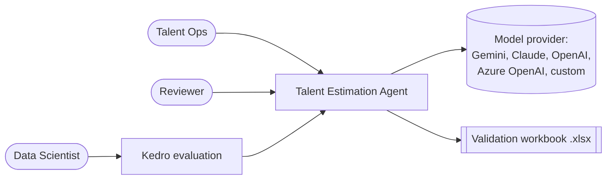
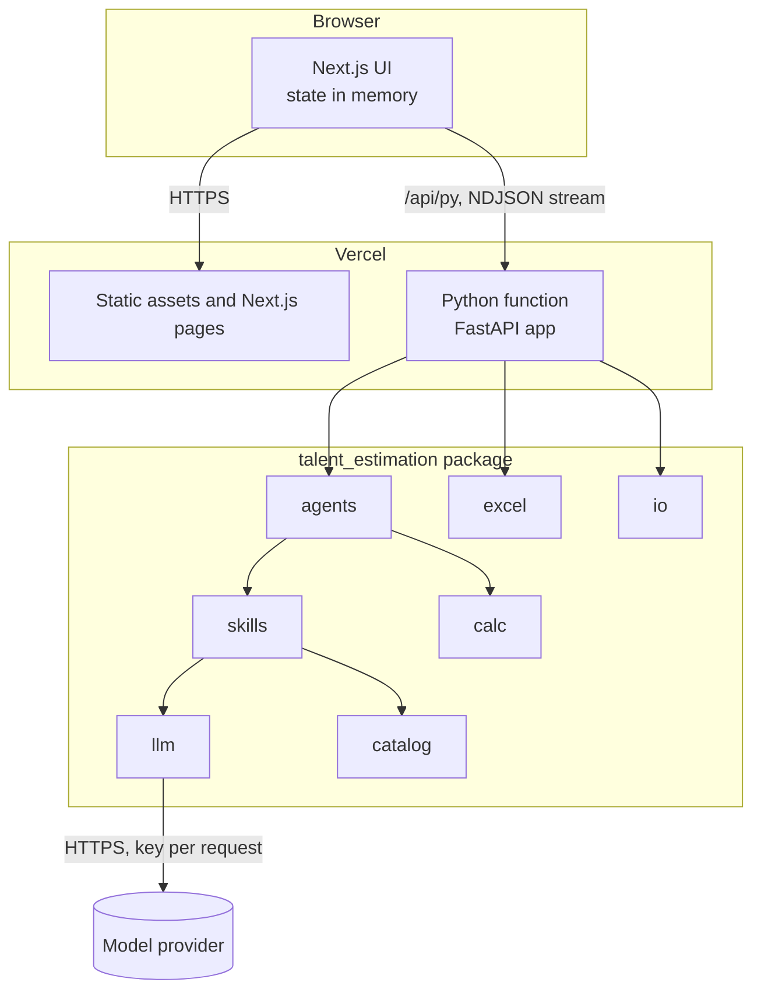
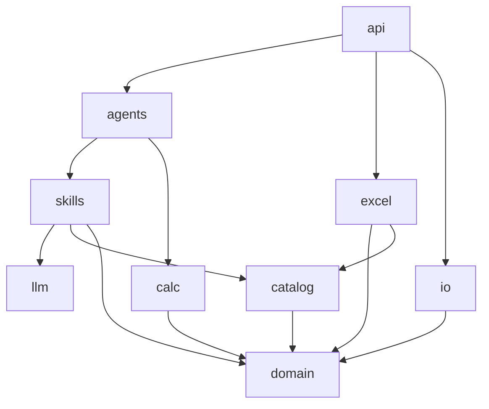
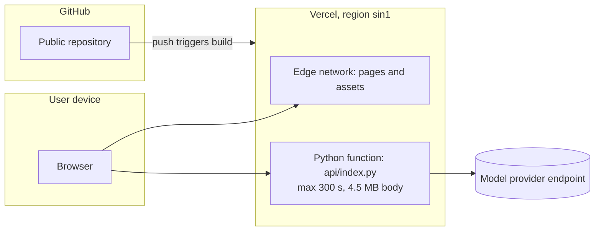

# Architecture

## Context

## Containers

## Layers and packages

| Layer | Package | Responsibility | Depends on |
|---|---|---|---|
| Presentation | `app/`, `components/`, `lib/` | Screens, state in memory, API calls | API |
| Interface | `api/index.py` | HTTP routes, uploads, streaming, validation | all below |
| Orchestration | `agents` | LangGraph graph, review loop, trace | skills, calc |
| Judgement | `skills` | Prompts, schemas, rule-based fallback, agent cards | llm, catalog, domain |
| Calculation | `calc` | UCP, bottom-up, monthly, comparison, AI scenario | domain |
| Output | `excel` | Workbook with formulas | domain, catalog |
| Input | `io` | WBS reader, document text | domain |
| Infrastructure | `llm` | Provider-agnostic structured output, masking | (LangChain) |
| Knowledge | `catalog` | Role catalog, rules, rubrics, AI categories | domain |
| Model | `domain` | Pydantic models | none |

Dependencies point downwards only. `domain` and `calc` have no third-party
dependency other than Pydantic, so they can be reused in other processes.

## Deployment

## Reuse in a larger agent system

The same package can be exposed in three ways without rewriting the core:

- **MCP server**: tools `validate_talent_request` (full graph) and
  `assess_ai_opportunity` (Augmentation Agent only).
- **A2A**: the agent cards returned by `GET /api/py/agents` describe each
  agent's skills and contracts.
- **LangGraph subgraph**: `build_graph(llm)` returns a compiled graph that can
  be added as a node of a larger graph.
