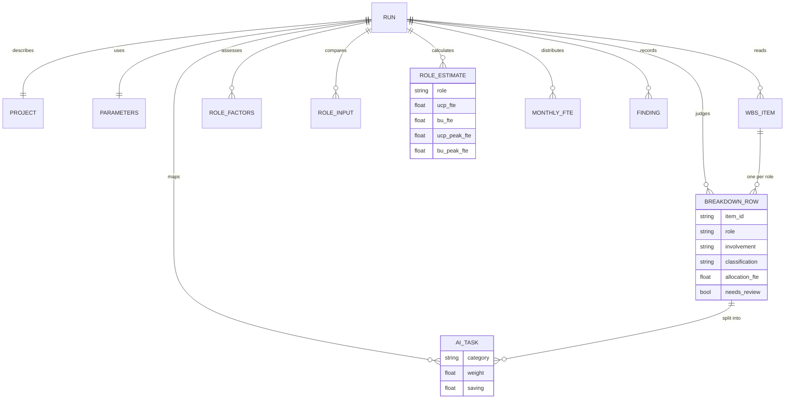

# Data management

## No persistence by design

The system has no database and writes no files on the server. This removes a
whole class of risks (retention, access control, breaches of stored data) and
fits the free hosting tier. The consequences are handled explicitly:

| Concern | Handling |
|---|---|
| Where does a run live? | In the browser tab, as a `RunResult` JSON object. |
| How does review work across requests? | The browser sends the run back to `/recalculate`, `/reclassify`, or `/excel`. |
| What if the tab closes? | The run is lost. The UI warns before closing and offers the workbook download at all times. |
| Human-in-the-loop in LangGraph | No checkpointer is needed because review happens after the graph finishes; re-judging is a new request. |
| Uploaded files | Read into memory, parsed, discarded at the end of the request. Size limit 4 MB. |

## Data model

The full model is in `src/talent_estimation/domain/models.py`. The entity view:

## Future storage

If run history is stored later (for example evaluation results in DuckDB or
PostgreSQL), the natural centre is the run: one row per run with the versions
of the catalog, prompts, and parameters used, and child tables for breakdown
rows, estimates, findings, and decisions. dbt would then build analytical
models such as accuracy per provider over time. See
[ADR 0006](../adr/0006-dbt-deferred.md).
