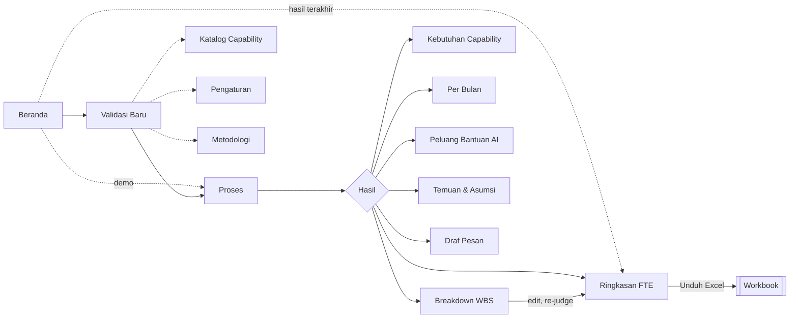

# User interface design

## Navigation

The sidebar has seven top-level entries, starting with **Beranda** (home).

### Many roles

Roles stay as rows, never as columns, so a longer role list grows the page
downward instead of forcing horizontal scrolling, which users tend to miss.
When a run covers more than one team, every result page shows the same
segmented control (**Semua tim · Data · Design**). The choice is shared across
pages so switching menu keeps the view. With all teams shown, cards and tables
are grouped under a team heading with a subtotal. Only the monthly table can
grow sideways for long projects; its role column stays fixed while the months
scroll. All outputs sit under **Hasil**, which
is disabled until a run exists. The header always shows the model status and
the **Unduh Excel** button.

## Screens

| Screen | Purpose | Key elements |
|---|---|---|
| Beranda | Orient and route | One-line value statement; primary "Mulai validasi" and secondary demo button; resume banner when a run exists; three-step how it works; outputs preview; setup checklist (model, catalog, WBS sample); trust strip |
| Validasi Baru | Start a run | Multi-file pickers (up to 5 per field, 4 MB in total) with an immediate WBS check per file and a merged total; clashing item IDs across WBS files get a file prefix; project fields; scope switch; AI toggle; collapsed advanced settings with a "n values changed" badge and reset; readiness checklist; run and demo buttons |
| Proses | Show progress | Six-step stepper with status per agent; activity log; elapsed time; cancel |
| Ringkasan FTE | Read the answer | Card per role (UCP, bottom-up, requested, existing, additional, conclusion); comparison table; review banner; approve |
| Breakdown WBS | Trace and correct | Filter by role and review status; search; inline edits; expandable reasons and capability levels; select rows and ask the agent |
| Kebutuhan Capability | What kind of talent | Per role: skills from the catalog, highest and average level (1-5), and the items that need each skill; level legend |
| Per Bulan | See the load over time | Stacked bars per role; table with peak and working days |
| Peluang Bantuan AI | AI scenario | Baseline to assisted FTE per role; most assisted capabilities; task table with editable saving |
| Temuan & Asumsi | Understand risks | Findings by severity; assumptions; agent trace |
| Draf Pesan | Reply | Editable draft; copy |
| Katalog Capability | Roles and rules | Role cards with scope and pillars; rules; upload for session |
| Pengaturan | Model access | Provider, model, endpoint, key (memory only), masking, connection test |

## Visual design

White surfaces on a light grey canvas, dark grey text, and a purple accent
for primary actions, the active navigation item, and active steps. Role
colours are always paired with the role code, and statuses are written as
words, so colour never carries meaning alone. Text and interactive elements
meet WCAG AA contrast.

## Heuristic evaluation (Nielsen Norman Group)

| Heuristic | Application |
|---|---|
| 1. Visibility of system status | Per-agent stepper with live messages; recalculation indicator; model status in the header; WBS check right after upload |
| 2. Match between system and the real world | Domain terms: FTE, man-hours, WBS item, role names; Indonesian copy; dates in local format |
| 3. User control and freedom | Cancel a run; edit any judgement; reset advanced settings; replace or reset the catalog |
| 4. Consistency and standards | Same number format, role badges, and button placement on every screen |
| 5. Error prevention | Run button enabled only when the checklist passes; numeric fields bounded; warning before closing a tab with results |
| 6. Recognition rather than recall | Reasons shown next to each row; defaults written under each field; role names next to codes |
| 7. Flexibility and efficiency of use | Filters and search; bulk re-judge; demo mode; advanced settings hidden until needed |
| 8. Aesthetic and minimalist design | Summary first, details on demand; zero-saving tasks hidden by default |
| 9. Help users recognize, diagnose, and recover from errors | Errors state the cause and the next step (for example, check the key or use the demo) |
| 10. Help and documentation | Tooltips on PHM, tolerance, and support factor; Metodologi page |
