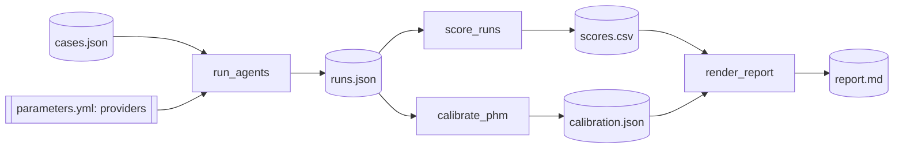

# Evaluation and calibration

The `evaluation/` folder is a Kedro project. It runs outside the deployed
application and never ships to Vercel.



## Cases

A case is a project whose staffing was reviewed by a lead:

```json
{
  "name": "project-a",
  "folder": "data/01_raw/project-a",
  "wbs": "wbs.xlsx",
  "request": "request.pdf",
  "supporting": "notes.docx",
  "reference_fte": {"DE": 3.0, "DA": 2.0, "DS": 1.5, "AI": 2.0}
}
```

Real cases stay in `evaluation/data/`, which git ignores. The committed sample
is fictional.

## Providers

`conf/base/parameters.yml` lists the providers to compare. Keys are read from
environment variables named in the file, never stored in it.

## Calibration

UCP FTE is proportional to PHM. For each case and role, `k = ucp_fte / phm`.
The least-squares PHM against reviewed references `r` is
`sum(k * r) / sum(k ** 2)`. The value is meaningful only with several
reviewed projects; the default of 9 comes from a single project.

```bash
cd evaluation
uv run kedro run
cat data/08_reporting/report.md
```
